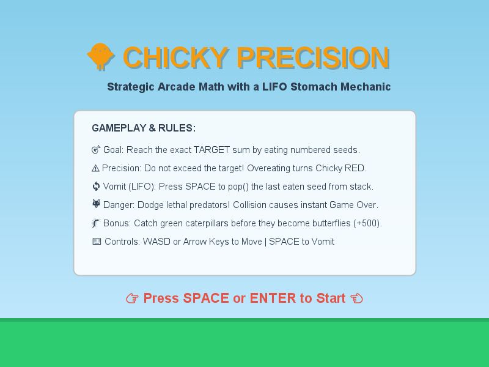
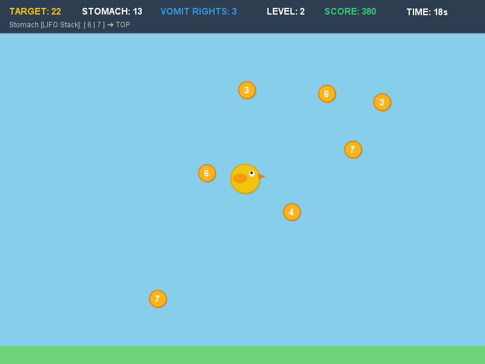
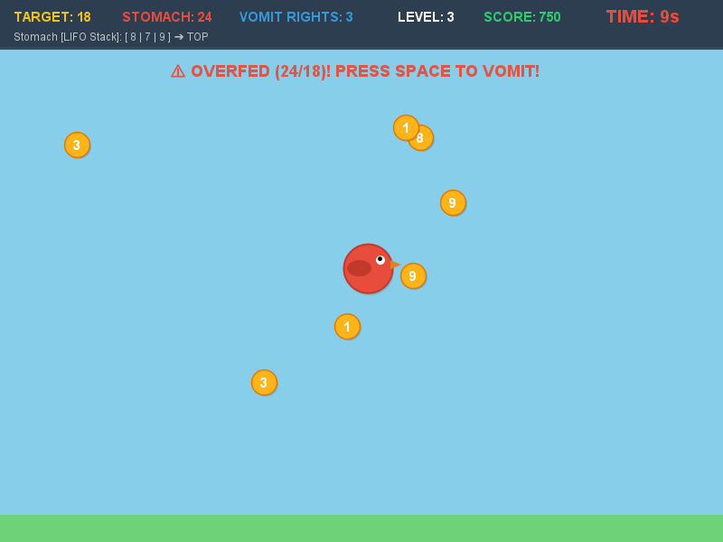
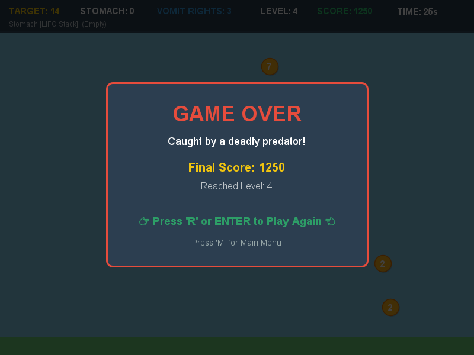
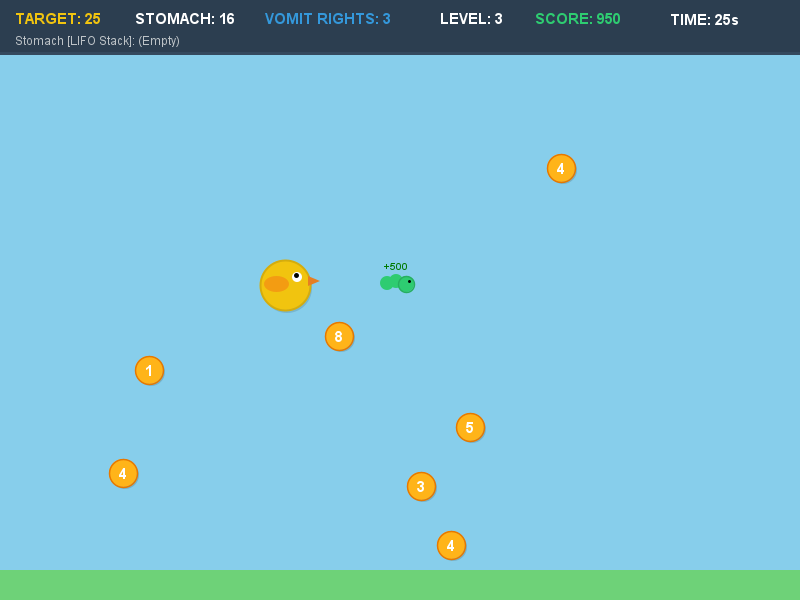
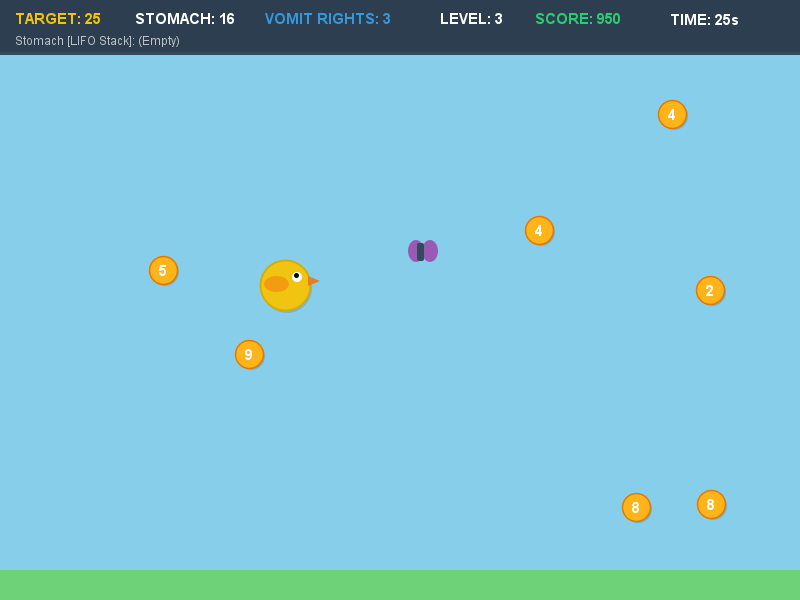

# 🐥 Chicky Precision

<p align="center">
  
</p>

<p align="center">
  <strong>A fast-paced strategic arcade game built in Java Swing featuring real-world LIFO (Stack) data structure mechanics.</strong>
</p>

<p align="center">
  <a href="#-features--mechanics"></a>
  <a href="#-technical-stack--architecture"></a>
  <a href="#-data-structure-in-action"></a>
  <a href="#-license"></a>
</p>

---

## 📖 Overview

**Chicky Precision** is a precision math arcade game where players control an eager little chick tasked with reaching an exact numeric target within a 25-second countdown. Every grain consumed enters Chicky's **Stomach** modeled as a strict **LIFO (Last-In-First-Out) Stack**. 

If you accidentally eat too much, Chicky turns **RED** from overfeeding! You must strategically use your limited **Vomit** charges (`Spacebar`) to `pop()` the most recently eaten foods until your total matches the target sum down to the exact digit.

---

## 📸 Screenshots & Gameplay Showcase

| 🏠 Main Menu | 🕹️ Active Gameplay & LIFO HUD |
| :---: | :---: |
|  |  |
| **Welcome & Rules Screen** | **Precision Feeding & Stack Tracking** |

| ⚠️ Overfed Alert (Red State) | 💀 Game Over & Score Summary |
| :---: | :---: |
|  |  |
| **Overeating Warning & Vomit Trigger** | **Stats, Highscore & Quick Restart** |

---

## 🐛 Caterpillar Evolution & Bonus Mechanic

Every 3 levels (`Level % 3 == 0`), a rare **Caterpillar** spawns at a random position on the field. Players are presented with a high-reward time-sensitive challenge:

| 🐛 Stage 1: The Caterpillar (+500 Bonus) | 🦋 Stage 2: The Butterfly (Too Late!) |
| :---: | :---: |
|  |  |
| **Catch within 2.5s for +500 PTS & Instant Level Up!** | **Transforms into a butterfly and flutters away—no bonus!** |

- **0.0s – 2.5s (Tırtıl Evresi):** Segmented green caterpillar with a floating `+500` badge. Catching it awards **+500 bonus points** and **instantly clears the level**!
- **2.5s – 4.5s (Kelebek Evresi):** Undergoes metamorphosis into a fluttering purple butterfly. Once transformed, it can no longer be caught or eaten.
- **After 4.5s:** The butterfly flies off-screen and disappears completely.

---

## 🕹️ Features & Mechanics

- 🎯 **Precision Counting:** Reach the randomly generated target sum perfectly. Not one more, not one less!
- 🥞 **LIFO Stomach System:** Every grain swallowed is stored in `java.util.Stack`. The last item eaten is always the first one popped.
- 🤮 **Vomiting Mechanic (Spacebar):** If you overshoot the target, consume a vomit charge to remove the topmost item from your stomach stack.
- 🦊 **Lethal Predators:** Quick-moving predators patrol the airspace. A single contact results in an instant Game Over.
- 🐛 **Caterpillar Metamorphosis:** High-stakes bonus event every 3 levels to accelerate your score!
- 🔴 **Dynamic Visual Feedback:** 
  - Chicky turns bright red when overfed.
  - Timer pulses in red during the critical final 10 seconds.
  - Live HUD bar displays the exact LIFO stack sequence: `Stomach [LIFO Stack]: [ 6 | 7 ] ➔ TOP`.
- 🔄 **Full State Machine:** Seamless flow between `MENU`, `PLAYING`, and `GAME_OVER` states with instant replay support (`R` or `ENTER`).

---

## ⌨️ Controls

| Key | Action | Context |
| :--- | :--- | :--- |
| <kbd>W</kbd> <kbd>A</kbd> <kbd>S</kbd> <kbd>D</kbd> or <kbd>↑</kbd> <kbd>←</kbd> <kbd>↓</kbd> <kbd>→ </kbd> | Move Chicky | In-Game |
| <kbd>Spacebar</kbd> | Vomit (Pops topmost food from Stack) | In-Game |
| <kbd>Spacebar</kbd> / <kbd>Enter</kbd> | Start Game | Main Menu |
| <kbd>R</kbd> / <kbd>Enter</kbd> | Quick Restart (Play Again) | Game Over Screen |
| <kbd>M</kbd> | Return to Main Menu | Game Over Screen |

---

## 🧠 Data Structure in Action

The core game loop highlights the practical application of a **LIFO (Last-In-First-Out) Stack**:

```java
// When Chicky eats food
stomach.push(food.value);
currentSum += food.value;

// When the player vomits (Spacebar)
if (!stomach.isEmpty() && vomitRights > 0) {
    int lastEaten = stomach.pop(); // Removes the topmost (most recent) item
    currentSum -= lastEaten;
    vomitRights--;
}
```

Players must plan their eating order strategically because they cannot pick and choose which food to remove—only the most recent item can be regurgitated!

---

## 📂 Project Structure

```text
chicky-precision-game/
├── .gitignore
├── README.md
├── assets/
│   └── screenshots/
│       ├── main-menu.png       # Menu & instructions screen
│       ├── gameplay-1.png      # In-game action with HUD & stack display
│       ├── gameplay-2.png      # Overfed red state & vomit warning
│       ├── caterpillar.png     # Level 3 caterpillar stage (+500 bonus)
│       ├── butterfly.png       # Transformed fluttering butterfly
│       └── game-over.png       # Game over overlay with final score
└── MainGame/
    ├── build.xml
    ├── manifest.mf
    ├── nbproject/
    └── src/
        ├── maingame/
        │   ├── Caterpillar.java        # Caterpillar lifecycle & bonus logic
        │   ├── Food.java               # Numbered food seeds with custom rendering
        │   ├── GamePanel.java          # Core game engine, 60 FPS loop & HUD
        │   ├── MainGame.java           # Application entry point (JFrame wrapper)
        │   ├── Predator.java           # Predator enemy movement & hitboxes
        │   └── ScreenshotCapture.java  # Automated headless screenshot generator
        └── res/                        # Game assets & sprite collection
```

---

## 🚀 Getting Started

### Prerequisites

- **Java Development Kit (JDK):** Version 8 or higher (tested on OpenJDK / Oracle JDK 23).
- **Git** installed on your system.

### Installation & Run

1. **Clone the repository:**
   ```bash
   git clone https://github.com/esilacodes/chicky-precision-game.git
   cd chicky-precision-game
   ```

2. **Compile the source files:**
   ```bash
   javac -d bin MainGame/src/maingame/*.java
   ```

3. **Launch the game:**
   ```bash
   java -cp bin maingame.MainGame
   ```

4. *(Optional)* **Regenerate screenshots:**
   ```bash
   java -cp bin maingame.ScreenshotCapture
   ```

---

## 🛠️ Technical Stack & Architecture

- **Engine:** Java Swing & AWT (`javax.swing.JPanel`, `javax.swing.Timer`).
- **Rendering:** Vector-based 2D Graphics via `java.awt.Graphics2D` with anti-aliasing hints.
- **Collision Detection:** AABB (Axis-Aligned Bounding Box) using `java.awt.Rectangle.intersects()`.
- **Target Frame Rate:** 60 FPS (16 ms timer tick).

---

## 📄 License

This project is licensed under the [MIT License](LICENSE) — feel free to explore, modify, and build upon it!
